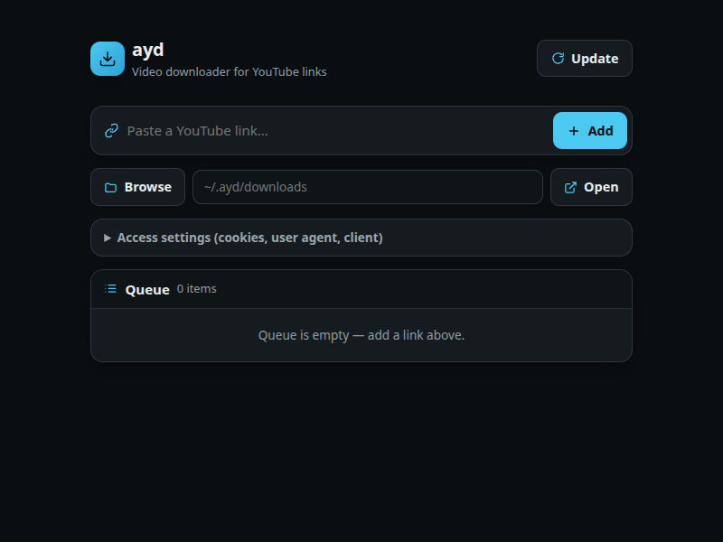

# ayd

An [aio](https://github.com/riagentic/aio) app — a video downloader for YouTube links, built on
`yt-dlp`. Paste a link, pick a format, download to `~/.ayd/downloads`
(changeable).



- **Formats** — every video+audio / video-only / audio-only format is listed;
  the best of each class is tagged (`recommended`, `best video`, `best audio`).
- **Download** — real-time progress bar, status line (`Ready` / `Downloading` /
  `Finished` / …), cancel.
- **Queue + optimal build** — best video + best audio merged by ffmpeg
  (H.264/AAC or VP9/Opus), one item after another; failed items stay queued.
- **Target dir** — manual path entry or an in-app folder browser.
- **Access settings** — cookies file, User-Agent, player client.
- **Update yt-dlp** — one button runs `yt-dlp --update`.

Downloads failing? YouTube changes often — click **Update** first. If yt-dlp
came from a package manager (pip, brew, apt), update it there instead.

Settings and the queue survive a restart; a run cut off by a restart starts
clean.

## Run

```sh
deno task dev                    # Electron desktop app (the default)
deno task dev --client=browser   # browser instead
deno task test                   # cell + UI tests
deno task check                  # type-check src/
deno task build                  # build targets in deno.json → dist/
```

`deno.json` sets `"client": "electron"`, so `deno task dev` opens the desktop
window by default; pass `--client=browser|cli|server-only` to override.

State lives in `src/cell.ts`; the server-only half (yt-dlp subprocess,
filesystem) is `src/ayd.server.ts`, dynamically imported so it never reaches the
browser bundle. App icon is `src/icon.png`.

yt-dlp is looked up as `$AYD_YTDLP` → `dep/yt-dlp/yt-dlp` → `yt-dlp` on PATH.
ffmpeg + ffprobe on PATH enable the optimal build. Tests use a fake yt-dlp
(`src/fake-ytdlp.ts`) — no network.

> **Cloned this repo?** `dep/`, `node_modules` are gitignored — run `am fix`
> once, and put yt-dlp in `dep/yt-dlp/` (or on PATH):
> `curl -L --create-dirs -o dep/yt-dlp/yt-dlp https://github.com/yt-dlp/yt-dlp/releases/latest/download/yt-dlp && chmod +x dep/yt-dlp/yt-dlp`
>
> To develop against a local aio checkout: `am pin <path>` (machine-local, in
> `.aio/pin.local`); `am pin latest` returns to a release.

## Use responsibly

ayd is for downloading videos you own or have permission to download. You are
responsible for following YouTube's Terms of Service and copyright law where
you live. ayd is not affiliated with or endorsed by YouTube or Google.

## License

[MIT](LICENSE). yt-dlp is not part of this repo; it has its own license.
